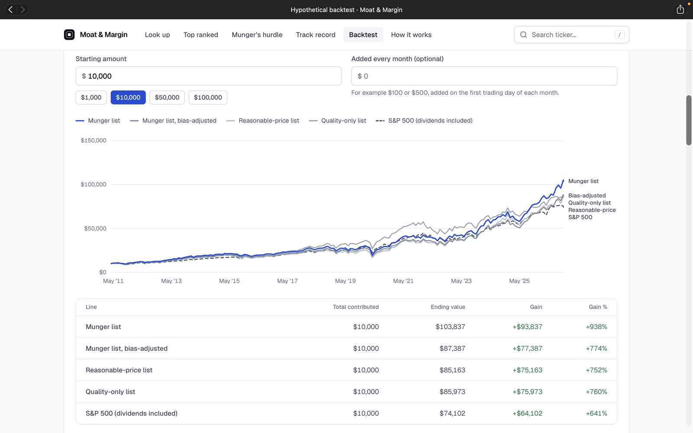
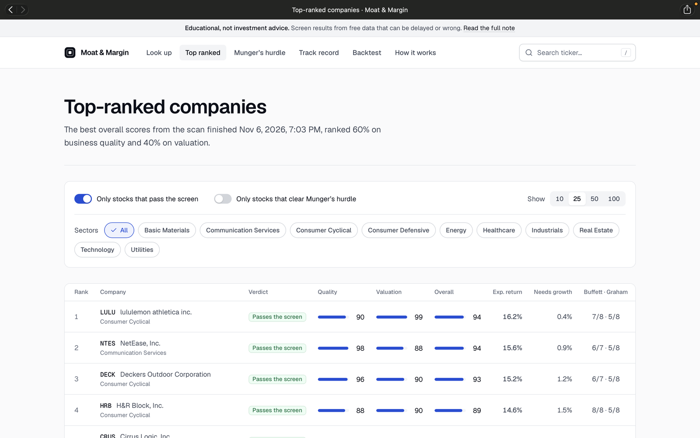
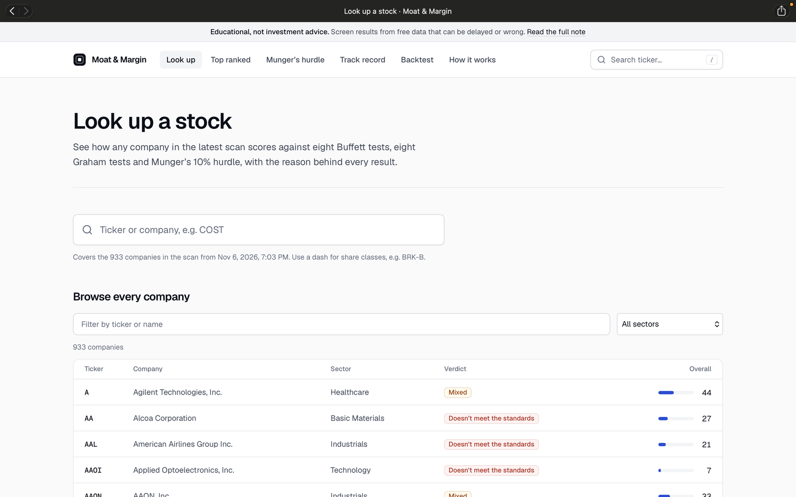

# Moat & Margin

**A quality-and-value stock screener inspired by Charlie Munger's investing principles.**

Built by Layton Niemier, Finance student at the University of South Florida (Class of 2030).

> The source code is kept private while the project is in development. This page shows what the project does, how it was tested, and what I learned.

---

## What it does

Moat & Margin screens 900+ U.S. companies for two things Charlie Munger cared about:

- **Moat:** a durable competitive advantage that protects a company's profits over time.
- **Margin:** a margin of safety, meaning the stock trades at a reasonable price compared to what the business is worth.

The goal is to find great businesses at fair prices, not just cheap stocks. A daily data pipeline keeps the screen up to date, and a companion website presents the picks and the research behind them.

## How it was tested

I ran a hypothetical point-in-time backtest from 2011 to 2026:

- Uses only financial data that was public on each date (SEC EDGAR filings), so the test can't "see the future"
- Keeps companies that were later delisted or went bankrupt, to avoid survivorship bias
- Rebuys an equal-weighted portfolio of the screen's picks once a year
- Accounts for estimated trading costs
- Repeats the whole test for all 12 possible rebalance months, to check whether the result depends on a lucky start date

## Results (hypothetical)

| | Result |
|---|---|
| Rebalance months ahead of the S&P 500 | **10 of 12** |
| Average edge over the S&P 500, after estimated costs | **about +0.8 points a year** |
| Example: April rebalance, after costs | 14.8% a year vs. 13.7% for the S&P 500 |

**What this does and doesn't show:** the screen modestly outperformed the S&P 500 in this test, but it isn't proven to beat the market. The yearly gaps were large compared with the small average edge, so the result isn't statistically significant. Much of the edge came from the last two years, and drawdowns were somewhat deeper than the S&P 500's. The real test is tracking it live over the coming years.

## Screenshots

**Hypothetical backtest:** growth of $10,000 from 2011, compared with the S&P 500. The "Munger list" line is before adjusting for delisted companies and trading costs; the more conservative "bias-adjusted" line is the one the results above are based on.

**Top-ranked companies:** the best overall scores from the latest scan, ranked 60% on business quality and 40% on valuation.

**Look up a stock:** see how any of the 900+ companies scores against eight Buffett tests, eight Graham tests and Munger's 10% hurdle.

## Built with

- **Python:** screener, backtest, and analysis
- **Streamlit:** interactive screener app
- **Next.js / TypeScript:** project website
- **Data:** SEC EDGAR (company filings), Yahoo Finance (prices), FRED (Treasury bill rates)
- **AI coding tools** (Claude Code): I designed the strategy and testing approach and built the project with an AI coding assistant, and I'm strengthening my Python skills by working through the code

## What I learned

- How to turn investing ideas like moats and margin of safety into rules a computer can apply
- How backtests mislead (look-ahead bias, survivorship bias, start-date luck) and how to guard against each
- Why a small edge needs years of evidence before anyone should trust it

## Disclaimer

This project is for learning purposes only. It is not investment advice. All backtest results are hypothetical, and past performance does not guarantee future results.

## Connect

- LinkedIn: [Layton Niemier](https://www.linkedin.com/in/layton-niemier-32ab002ab/)
